

  

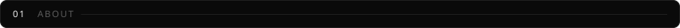

  

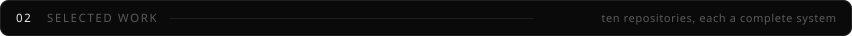

  <a href="https://github.com/TIENDUNG21/lyra-neural-verse"></a>
  <a href="https://github.com/TIENDUNG21/bastion-llm-firewall"></a>

  <a href="https://github.com/TIENDUNG21/granite-sql-engine"></a>
  <a href="https://github.com/TIENDUNG21/concord-raft-cluster"></a>

  <a href="https://github.com/TIENDUNG21/flock-realtime-collab"></a>
  <a href="https://github.com/TIENDUNG21/hush-zero-knowledge-vault"></a>

  <a href="https://github.com/TIENDUNG21/argus-threat-sentinel"></a>
  <a href="https://github.com/TIENDUNG21/veritas-image-forensics"></a>

  <a href="https://github.com/TIENDUNG21/orrery-sky-atlas">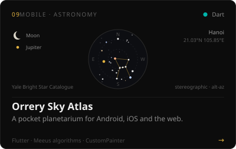</a>
  <a href="https://github.com/TIENDUNG21/polis-css-metropolis"></a>

